# NetSigorta — Kasko Teklif ve Poliçe Yönetim Platformu


> 🌐 **Canlı Demo:** [netsigorta.online](https://netsigorta.online/) — Demoyu buradan deneyebilirsiniz. Giriş bilgileri için [Demo Hesapları](#demo-hesapları) bölümüne bakın.

NetSigorta, kasko sigortasının uçtan uca satış ve yönetim sürecini dijitalleştiren bir **Core Insurance** platformudur. ASP.NET Core 8 Web API ve Angular 22 ile geliştirilmiştir. Müşteri ve araç kaydından başlayarak fiyatlandırma, teklif, poliçeleştirme, ödeme, iptal/iade ve yenileme adımlarının tamamını tek bir sistemde yönetir.

```
Müşteri ➔ Araç ➔ Fiyatlandırma Motoru ➔ Teklif ➔ Poliçe ➔ Ödeme ➔ İptal / İade ➔ Yenileme
```

---

## İçindekiler

- [Ekran Görüntüleri](#ekran-görüntüleri)
- [Demo Hesapları](#demo-hesapları)
- [Öne Çıkan Özellikler](#öne-çıkan-özellikler)
- [Mimari](#mimari)
- [Teknoloji Yığını](#teknoloji-yığını)
- [Proje Yapısı](#proje-yapısı)
- [Kurulum](#kurulum)
- [Testler](#testler)
- [CI/CD ve Dağıtım](#cicd-ve-dağıtım)
- [Yol Haritası](#yol-haritası)

---

## Ekran Görüntüleri

<table>
  <tr>
    <td width="50%"><b>Hızlı Teklif — Paket Karşılaştırma</b><br>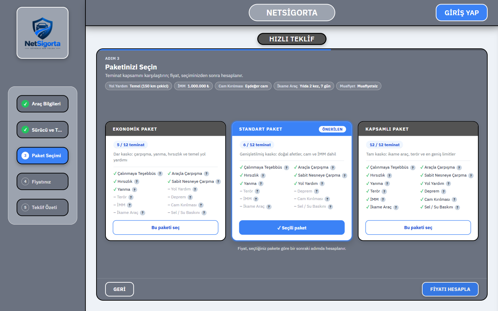</td>
    <td width="50%"><b>Formül Motoru — Adım Adım Prim Hesabı</b><br>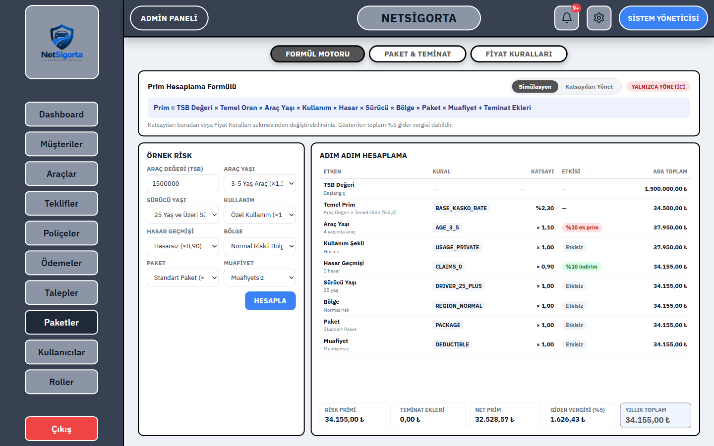</td>
  </tr>
</table>

<details>
<summary><b>Diğer ekranlar (9)</b></summary>
<br>

<table>
  <tr>
    <td width="50%"><b>Hızlı Teklif — Başlangıç</b><br>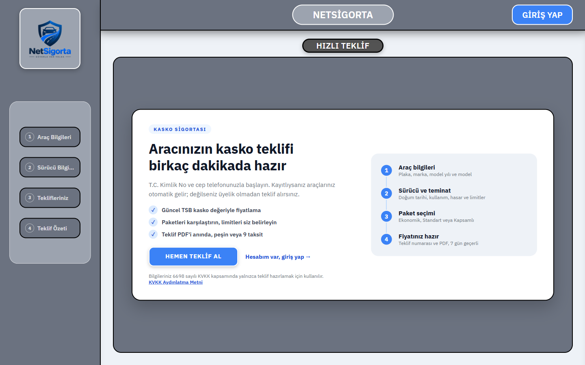</td>
    <td width="50%"><b>Hızlı Teklif — Fiyat</b><br>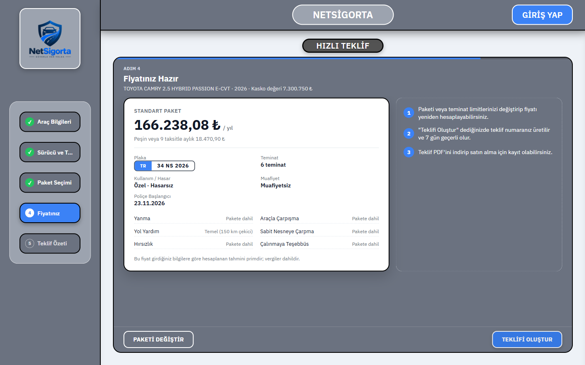</td>
  </tr>
  <tr>
    <td><b>Müşteri Portalı — Dashboard</b><br>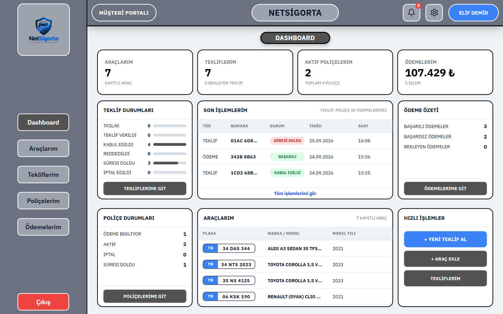</td>
    <td><b>Müşteri Portalı — Poliçelerim</b><br>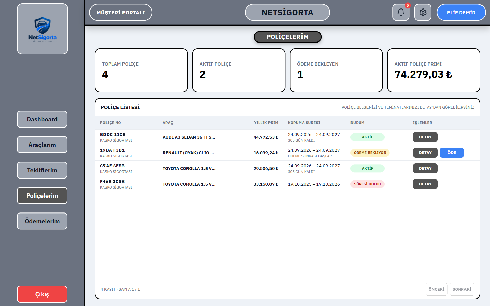</td>
  </tr>
  <tr>
    <td><b>Yönetici Paneli — Dashboard</b><br>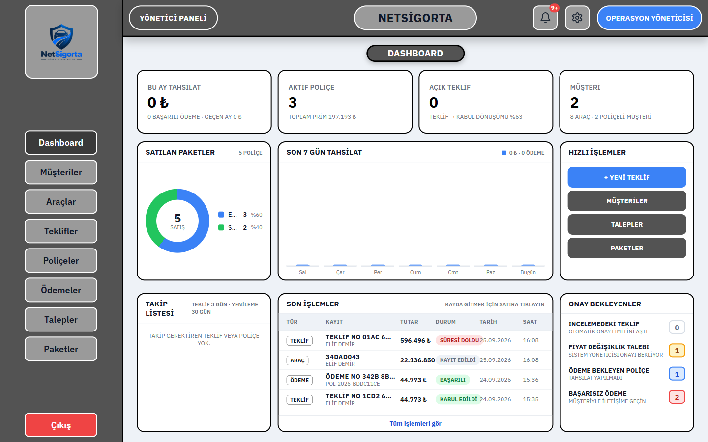</td>
    <td><b>Paket ve Teminat Yönetimi</b><br>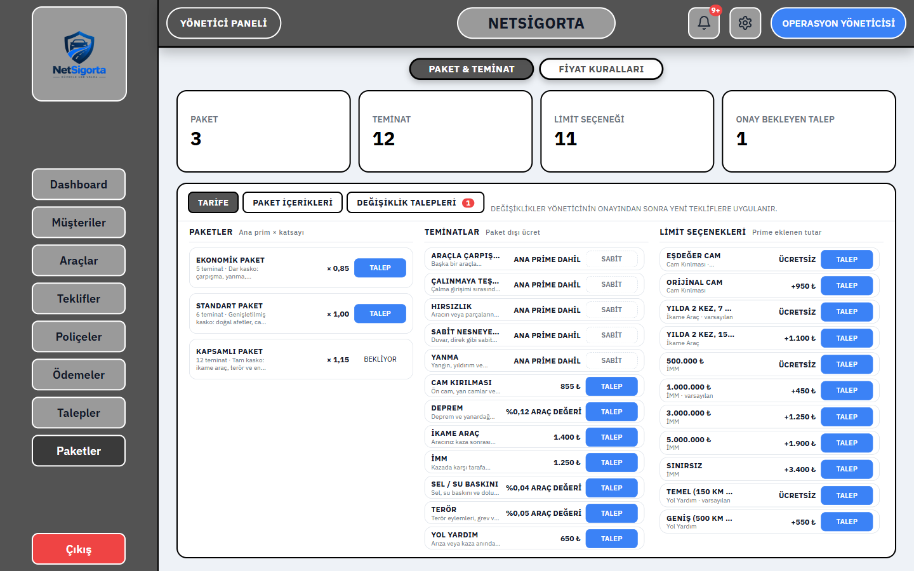</td>
  </tr>
  <tr>
    <td><b>Fiyat Kuralları (Sürümlü)</b><br>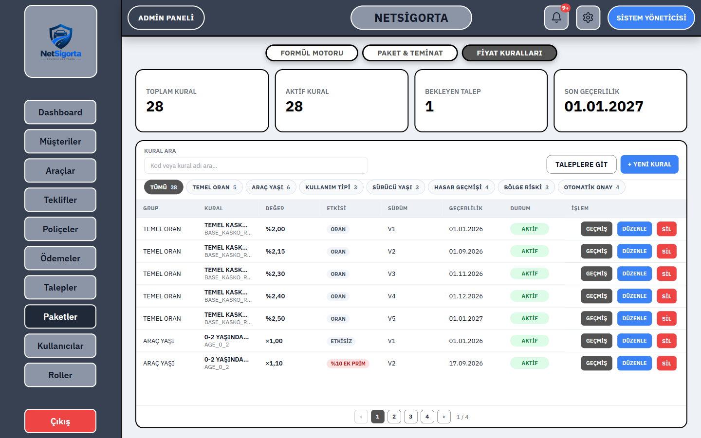</td>
    <td><b>Fiyat Değişikliği Onay Akışı (Admin)</b><br>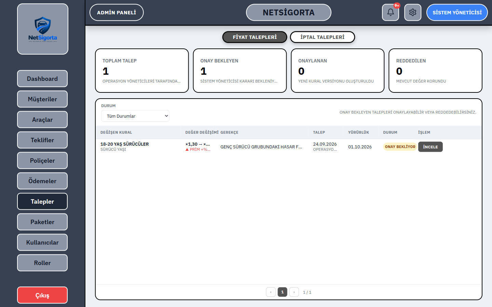</td>
  </tr>
  <tr>
    <td><b>Kullanıcı Yönetimi (Admin)</b><br>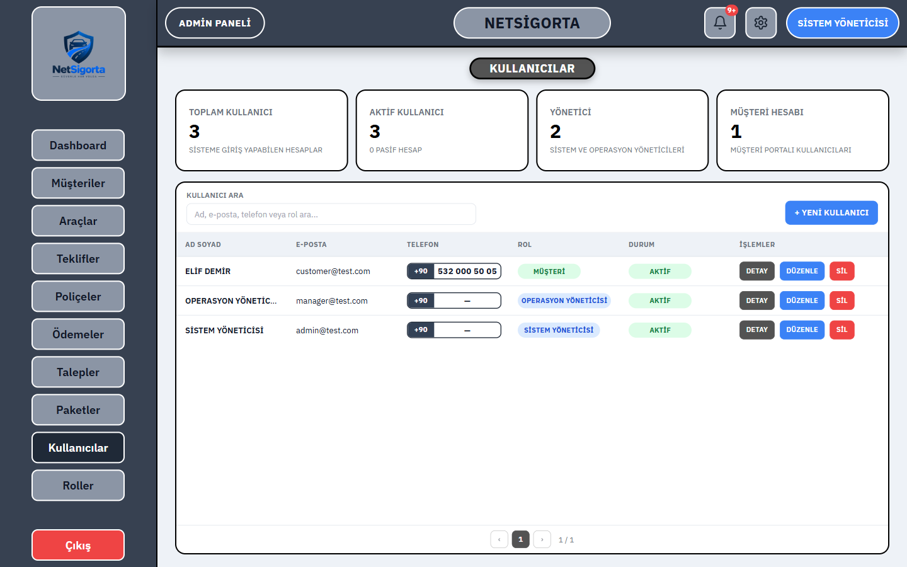</td>
    <td></td>
  </tr>
</table>

</details>

---

## Demo Hesapları

Uygulamayı farklı rollerle denemek için aşağıdaki hesapları kullanabilirsiniz:

| Rol | E-posta | Şifre | Neler denenebilir? |
|---|---|---|---|
| Müşteri | `customer@test.com` | `Test123!` | Hızlı teklif, teklif onayı, poliçe ve ödeme geçmişi, poliçe PDF'i |
| Yönetici (Manager) | `manager@test.com` | `Test123!` | Personel paneli, müşteri/araç/teklif/poliçe yönetimi, fiyat kuralı değişiklik talebi |

> ⚠️ Bu hesaplar herkese açık demo hesaplarıdır. Şifre, e-posta ve hesap durumu değiştirilemez; şifre sıfırlama da kapalıdır. Lütfen gerçek kişisel bilgi girmeyin.
>
> Admin yetkileri (kullanıcı/rol yönetimi, fiyat kuralı onayı) güvenlik nedeniyle herkese açık değildir. Erişim için geliştiriciyle iletişime geçebilirsiniz.

---

## Öne Çıkan Özellikler

### Dinamik Fiyatlandırma Motoru
- Fiyatlar koda gömülü değildir. Tutarlar veritabanındaki `PricingRule` kurallarından hesaplanır.
- Kurallar `EffectiveFrom` / `EffectiveUntil` tarihleriyle **versiyonlanır**. Geçmiş teklifler, oluşturuldukları andaki kurallarla tutarlı kalır.
- **Onay akışı:** Yönetici (Manager) katsayı değişikliği talep eder, Admin onaylar (`PricingRuleChangeRequest`, `TariffChangeRequest`).
- **Fiyat simülatörü:** Kural değişikliklerinin etkisi, canlıya alınmadan önce simüle edilebilir.

### Hızlı Teklif (Quick Quote)
- Üye olmadan teklif alma: plaka, araç ve kişi bilgisiyle dakikalar içinde fiyat tahmini.
- Türk plaka formatı doğrulaması, araç teknik özellik ayrıştırma ve otomatik araç kategorisi sınıflandırma.
- Doğrulama kodu (OTP) ile kimlik teyidi.
- **Sigorta şirketi karşılaştırması:** Tak-çıkar sağlayıcı mimarisi (`IInsurerQuoteProvider`) ile birden fazla şirketin teklifi karşılaştırılır. Şu an üç **demo** sağlayıcı kullanılmaktadır; gerçek şirket entegrasyonu aynı arayüzle eklenebilir.

### Paket ve Teminat Yönetimi
- `InsurancePackage` (Genişletilmiş Kasko, Dar Kasko vb.) ve `Coverage` / `CoverageOption` yapısıyla kod yazmadan yeni ürün tanımlanabilir.
- Teminat bazında farklı fiyatlama türleri (`CoveragePricingType`).

### Poliçe Yaşam Döngüsü
- Teklifin fiyat anlık görüntüsü (`QuotePricingSnapshot`) saklanır. Poliçeleşme anında fiyat sonradan değişmez.
- **PDF poliçe** üretimi (QuestPDF).
- Ödeme kaydı ve takibi.
- İptal talebi ve iade süreçleri (`PolicyCancellationRequest`).
- Yaklaşan yenilemelerin listelenmesi ve poliçeden **yenileme teklifi** oluşturma.
- Süresi dolan poliçe ve teklifleri otomatik olarak `Expired` durumuna alan arka plan işi (`ExpirationWorker`).

### Araç Değer Kataloğu
- Excel üzerinden toplu araç değer listesi içe aktarma (ClosedXML).
- İçe aktarma arka planda çalışır (`CatalogImportWorker`), ilerleme durumu anlık izlenebilir.

### Rol Tabanlı Portallar (RBAC)
| Portal | Kapsam |
|---|---|
| **Admin** | Kullanıcı ve rol yönetimi, fiyatlandırma kuralı onayı, marka ve sistem ayarları |
| **Manager** | Müşteri, araç, teklif ve poliçe operasyonları, fiyat değişikliği talepleri, iptal talepleri |
| **Müşteri** | Kendi araçları, teklifleri, poliçeleri, ödemeleri ve profili; hızlı teklif |

### Bildirimler ve Denetim
- Personel ve müşteri için uygulama içi bildirimler.
- Kayıt değişikliklerinde kim/ne zaman bilgisini tutan denetim (auditing) altyapısı.

---

## Mimari

Backend, sorumlulukların net ayrıldığı **katmanlı mimari** ile kurgulanmıştır:

```
┌───────────────────────────────────────────────┐
│  Angular 22 SPA (Standalone Components)       │
│  Guards · Interceptors (Auth / Error / Loading)│
└──────────────────────┬────────────────────────┘
                       │ HTTPS / JSON (JWT)
┌──────────────────────▼────────────────────────┐
│  Kasko.API        Controllers · Middleware ·   │
│                   Background Jobs · Swagger    │
├───────────────────────────────────────────────┤
│  Kasko.Business   Servisler · Fiyatlandırma ·  │
│                   Validators · Entegrasyonlar  │
├───────────────────────────────────────────────┤
│  Kasko.DataAccess EF Core · Repository ·       │
│                   Unit of Work · Migrations    │
├───────────────────────────────────────────────┤
│  Kasko.Entities   Varlıklar · Enum'lar         │
└──────────────────────┬────────────────────────┘
                       │
                      SQL Server
```

**Kullanılan desenler:** Repository, Unit of Work, DTO, Strategy (sigorta şirketi sağlayıcıları), Background Service, global exception middleware.

---

## Teknoloji Yığını

| Katman | Teknolojiler |
|---|---|
| **Backend** | .NET 8, ASP.NET Core Web API, Entity Framework Core 8 (Code-First), SQL Server |
| **Güvenlik** | JWT Bearer, rol tabanlı yetkilendirme, ASP.NET Core Identity `PasswordHasher` (PBKDF2) |
| **Doğrulama** | FluentValidation |
| **Doküman** | QuestPDF (poliçe PDF), ClosedXML (Excel içe aktarma) |
| **API Dokümantasyonu** | Swagger / OpenAPI (Swashbuckle) |
| **Frontend** | Angular 22, TypeScript 6, RxJS, SCSS, Reactive Forms |
| **Test** | xUnit, Moq, WebApplicationFactory, Coverlet (backend) |
| **Dağıtım** | Kendi sunucu barındırma (önceden Azure + GitHub Actions) |

---

## Proje Yapısı

```
.
├── Backend/KaskoManagementSystem
│   ├── Kasko.API                 # Controller'lar, middleware, arka plan işleri, Program.cs
│   ├── Kasko.Business            # İş kuralları, fiyatlandırma motoru, DTO, validator, entegrasyonlar
│   ├── Kasko.DataAccess          # DbContext, repository'ler, EF Core migration'ları
│   ├── Kasko.Entities            # Domain varlıkları ve enum'lar
│   ├── Kasko.Shared              # Paylaşılan kütüphane (genişletme için ayrıldı)
│   ├── Kasko.Business.Tests      # Birim testleri
│   └── Kasko.IntegrationTests    # Uçtan uca API testleri
├── Fronted/KaskoManagementSystemFronted
│   └── src/app
│       ├── core                  # Servisler, guard'lar, interceptor'lar, modeller, pipe'lar
│       └── features              # auth, dashboard, customers, vehicles, quotes, quick-quotes,
│                                 # policies, payments, cancellations, pricing, packages,
│                                 # users, roles, notifications, settings, customer-portal
└── .github/workflows             # Backend ve frontend dağıtım iş akışları
```

---

## Kurulum

### Gereksinimler
- [.NET 8 SDK](https://dotnet.microsoft.com/download/dotnet/8.0)
- [Node.js](https://nodejs.org/) (LTS) ve npm
- SQL Server (LocalDB, Express veya Developer)
- EF Core CLI: `dotnet tool install --global dotnet-ef`

### 1. Backend

```bash
cd Backend/KaskoManagementSystem
```

`Kasko.API/appsettings.json` içindeki bağlantı dizesini kendi ortamınıza göre düzenleyin:

```json
"ConnectionStrings": {
  "DefaultConnection": "Server=.;Database=KaskoManagementDb;Trusted_Connection=True;TrustServerCertificate=True;"
}
```

JWT imzalama anahtarı depoda tutulmaz. Geliştirme ortamında User Secrets ile tanımlayın (en az 32 karakter):

```bash
dotnet user-secrets set "Jwt:Key" "<en-az-32-karakterlik-gizli-anahtar>" --project Kasko.API
```

Veritabanını oluşturun ve API'yi başlatın:

```bash
dotnet ef database update --project Kasko.DataAccess --startup-project Kasko.API
dotnet run --project Kasko.API --launch-profile https
```

Swagger arayüzü: `https://localhost:7086/swagger` · Sağlık kontrolü: `https://localhost:7086/health`

### 2. Frontend

```bash
cd Fronted/KaskoManagementSystemFronted
npm install
npm start
```

Uygulama `http://localhost:4200` adresinde açılır. Geliştirme ortamında API adresi `src/environments/environment.ts` dosyasındaki `apiBaseUrl` değeriyle belirlenir (`https://localhost:7086/api`).

### Yapılandırma Anahtarları

| Anahtar | Açıklama |
|---|---|
| `ConnectionStrings:DefaultConnection` | SQL Server bağlantı dizesi |
| `Jwt:Key` | JWT imzalama anahtarı (gizli tutulmalı) |
| `Jwt:Issuer`, `Jwt:Audience`, `Jwt:ExpireMinutes` | Token ayarları |
| `Cors:Origins` | İzin verilen frontend adresleri (varsayılan `localhost:4200`) |
| `EnableSwagger` | Production ortamında Swagger'ı açar |
| `Demo:ExposeVerificationCodes` | Demo amaçlı doğrulama kodlarını yanıtta gösterir. **Gerçek ortamda `false` olmalıdır.** |
| `Demo:ProtectedAccounts` | Herkese açık demo hesaplarının e-posta listesi. Bu hesaplarda şifre/e-posta değişikliği, şifre sıfırlama, silme ve pasife alma engellenir. |

Sunucu ortamında bu anahtarlar `appsettings.Production.json` dosyasıyla ya da `Jwt__Key`, `Cors__Origins__0` biçiminde ortam değişkeni olarak tanımlanabilir.

---

## Testler

Backend'de iki test projesi bulunur:

| Proje | Kapsam |
|---|---|
| `Kasko.Business.Tests` | Servis katmanı birim testleri (xUnit + Moq) |
| `Kasko.IntegrationTests` | `WebApplicationFactory` ile uçtan uca API ve yetkilendirme testleri |

```bash
cd Backend/KaskoManagementSystem
dotnet test
```

> Entegrasyon testleri yerel SQL Server üzerinde `KaskoManagementDb_Test` veritabanını kullanır (`Kasko.IntegrationTests/TestDatabaseInitializer.cs`). Farklı bir sunucu kullanıyorsanız bu dosyadaki bağlantı dizesini düzenleyin.

---

## CI/CD ve Dağıtım

Canlı ortam [netsigorta.online](https://netsigorta.online/) adresinde, kendi sunucumuzda barındırılmaktadır. Yayın paketleri şu komutlarla üretilir:

```bash
# Backend
cd Backend/KaskoManagementSystem
dotnet publish Kasko.API -c Release -o ./publish

# Frontend
cd Fronted/KaskoManagementSystemFronted
npx ng build --configuration production
```

Production API adresi `src/environments/environment.production.ts` içindeki `apiBaseUrl` ile tanımlanır.

> Proje daha önce Azure App Service ve Azure Static Web Apps üzerinde GitHub Actions ile otomatik yayınlanıyordu; bu iş akışları (`.github/workflows/`) referans olarak depoda tutulmaktadır.

---

## Yol Haritası

- ✅ Fiyatlandırma modülü, kural versiyonlama ve değişiklik talepleri
- ✅ Sigorta paketi ve teminat yönetimi, teklif sihirbazı, fiyatlama motoru
- ✅ Hızlı teklif, Admin / Manager / Müşteri portalları
- ✅ PDF poliçe, ödeme, iptal/iade ve yenileme süreçleri
- ✅ Sigorta şirketi teklif karşılaştırması (demo sağlayıcılar)
- ✅ Canlı ortama alma (önce Azure, şimdi kendi sunucu)
- 🔄 Gerçek SMS, e-posta ve ödeme sağlayıcı entegrasyonları
- ⏳ Yapay zekâ destekli müşteri asistanı ve anlık (push / e-posta) bildirimler

---

## Geliştirici

**Yusuf Karadaş** — [GitHub](https://github.com/yusufkaradas)
